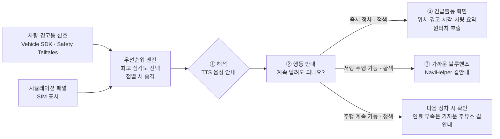

# 경고등 통역사 (Warning Light Interpreter)

> 고장 알림은 뜨는데 **"무슨 고장인지, 계속 달려도 되는지"** 모르는 운전자를 위해,
> 경고가 켜진 순간 그 의미와 주행 지속 여부(제조사 매뉴얼 기준)를 음성으로 알려주고
> 정비소 길안내·긴급출동까지 이어주는 Pleos Connect 인포테인먼트 앱입니다.

📺 **데모 영상 (102초, 앱 음성 포함)**: [warning-light-interpreter-demo.mp4](https://github.com/cheongsomon/warning-light-interpreter/releases/download/v0.1.0/warning-light-interpreter-demo.mp4) — Pleos Connect Emulator 화면 녹화. 앱이 실제로 낸 Pleos TTS 음성이 들어 있고, 같은 문장이 화면 하단 자막으로도 표시됩니다.  
📦 **APK**: [`apk/cheongsomon_경고등통역사_release.apk`](apk/cheongsomon_경고등통역사_release.apk) (release 빌드) · [Releases](../../releases)

---

> **핵심 목표** — 경고등이 켜진 순간, 운전자가 화면을 보지 않고도 몇 초 안에 *"계속 달려도 되는지, 지금 무엇을 해야 하는지"* 판단하게 돕는다. 모든 기능은 **해석 → 판단 → 행동** 3단계를 위해 존재한다.

## 0. 테스트 환경 (공모전 제출 기준)

| 항목 | 내용 |
|---|---|
| 앱 | 경고등 통역사 — 경고등이 켜진 순간 의미와 주행 지속 여부를 음성으로 안내하고 정비소 길안내·긴급출동으로 연결 |
| 에뮬레이터 | **Pleos Connect Emulator v2.1.0** (`release_connect_v2.1.0`, Android 14 / API 34, Automotive, arm64) |
| 화면 규격 | **2560 × 1440, mdpi(160dpi), 가로** — Pleos 기본 분할 화면의 앱 영역에서 동작 확인 |
| 개발·검증 PC | Apple Silicon Mac (M4), JDK 17, Android SDK 35 |
| 필요한 설정 | AVD Boot option = **Cold boot**, RAM 4GB. 에뮬레이터 2.1.0은 CRN 불필요. TTS 서버 합성을 쓰려면 `local.properties`에 Client ID/Secret (없으면 온디바이스 음성) |
| APK | [`apk/cheongsomon_경고등통역사_release.apk`](apk/cheongsomon_경고등통역사_release.apk) — 비밀값이 제외된 release 빌드 |
| 실행 | `adb install -r -g apk/cheongsomon_경고등통역사_release.apk` 후 런처에서 "경고등 통역사" 실행. 화면 오른쪽 시뮬레이션 패널로 경고를 발생시켜 시연 |

## 1. 문제 정의

차량은 이미 고장 알림을 띄워 줍니다. 문제는 그다음입니다.

- **이게 무슨 고장인가?** 아이콘과 짧은 문구만으로는 어떤 문제인지, 얼마나 심각한지 알기 어렵습니다.
- **계속 달려도 되나?** 지금 세워야 하는지, 목적지까지 가서 정비소에 들러도 되는지 판단할 수 없습니다.
- 같은 엔진 경고등이라도 **점등과 점멸은 대응이 다릅니다.** 매뉴얼은 글러브박스 속에 있어서 주행 중에는 읽을 수 없습니다.

그 결과 운전자는 주행 중 스마트폰으로 검색하거나, 위험한 경고를 무시하거나, 정보성 경고에 과하게 놀랍니다.

## 2. 3단계 흐름



| 심각도 | 화면 문구 (주행 지속 여부) | 예시 | 연결 |
|---|---|---|---|
| 🔴 STOP_NOW | **즉시 정차** | 브레이크, 엔진오일 압력, 엔진 과열, 엔진 경고등 **점멸** | 긴급출동 화면 (제조사 긴급출동 + 한국도로공사 긴급견인 1588-2504, 고속도로면 대피 안내 우선) |
| 🟡 SERVICE_SOON | **서행 주행 가능 · 오늘 중 정비** | 엔진 경고등 점등, 타이어 공기압, 에어백, ABS | 가까운 블루핸즈 길안내 |
| 🔵 INFO | **주행 계속 가능** | 연료 부족, 워셔액 부족 | 연료 부족은 가까운 주유소 길안내 |

경고마다 **"영향을 받을 수 있는 기능"**을 함께 보여주고 읽어줍니다. 운전자는 경고 이름보다 *지금 내 차가 무엇을 못 하는지*를 알아야 운전 방식을 바꿀 수 있기 때문입니다.

| 경고 | 영향을 받을 수 있는 기능 |
|---|---|
| ABS 경고 | 급제동 시 바퀴 잠김 방지(ABS), 차체 자세 제어(ESC) |
| 전동식 조향장치 경고 | 조향 보조 (핸들이 무거워짐) |
| 충전 경고 | 배터리 충전, 에어컨·열선 등 전기 장치, 시동 유지 |
| 에어백 경고 | 사고 시 에어백 전개, 안전벨트 프리텐셔너 |
| 타이어 공기압 경고 | 타이어 공기압 감시, 제동·코너링 안정성 |

앱이 읽는 문장은 화면 하단 **음성 안내 자막**에도 그대로 표시합니다 (소음 환경·청각 보조).

시동(앱 시작) 시에는 **차량 상태 브리핑**으로 현재 켜진 경고를 한 문장으로 요약합니다.

### 부가 기능
- **경고 블랙박스**: 경고가 켜지고·점멸로 바뀌고·꺼진 시각, 지속시간, 동시 경고를 시간순 기록. 반복되거나 금방 꺼진 경고는 "간헐 경고 의심" 표시. 기존 DTC가 남기지 않는 *발생 시점*을 남겨 간헐 고장 재현 문제를 보완. 보관: 정보 7일 · 정비 권장 30일 · 즉시 정차 영구(직접 삭제 전까지).
- **가족에게 알리기**: 미리 등록한 가족에게 켜진 경고 전체·안내·현재 위치 지도 링크를 차량 문자 기능으로 전송.
- **음성 안내 자막**: TTS로 읽는 문장을 화면 하단에 그대로 표시.

## 3. 사용한 Pleos SDK / API

| SDK | 버전 | 사용 API | 용도 |
|---|---|---|---|
| Vehicle | 2.3.2 | `Safety.checkTelltalesCapabilities`, `getTelltalesInfo`, `registerTelltales` | 경고등 목록 (종류 + OFF/ON/**BLINK**) 실시간 구독 |
| | | `Safety.check/registerBrakeFluidLevelState`, `EngineOilLevelState`, `LowWasherFluidWaringState` | 브레이크액·엔진오일 레벨, 워셔액 부족 |
| | | `Odometer.getRangeRemainingDistance` | 연료 부족 시 남은 주행가능거리 안내 |
| | | `CarInfo.getVINInfo` | 긴급출동 화면 차량 정보 |
| TextToSpeech | 3.3.1 | `TextToSpeech(context, Mode.HYBRID)`, `initialize`, `registerApp`, `speak`, `stop` | 해석·행동 지침 음성 안내 |
| NaviHelper | 3.0.5 | `initialize`, `getCurrentLocationInfo`, `requestRoute(RouteInfo)` | 현재 위치 기준 최단 거리 정비소 길안내 |

## 4. 설계 원칙

1. **진단하지 않는다.** 앱은 고장을 판정하지 않고 *제조사 매뉴얼 기준 안내*만 전달합니다.
2. **클러스터를 대체·반박하지 않는다.** 계기판 경고 표시를 보완하는 QM 수준 인포테인먼트 앱입니다.
3. **최고 심각도 우선.** 복수 경고가 동시에 켜지면 가장 위급한 경고 기준으로 안내하고, 더 위급한 경고가 들어오면 진행 중인 안내를 끊고 전환합니다.
4. **점등/점멸 구분.** SDK `TelltaleState.BLINK`를 받아 엔진 경고등 점멸 시 즉시 정차 단계로 승격합니다.
5. **주행 중 조작 최소화.** 음성 우선, 큰 글씨, 화면당 핵심 버튼 1개.
6. **정직한 표시.** 시뮬레이션으로 발생한 경고는 화면에 `SIM`, 실제 차량 신호는 `차량 신호`로 표시합니다. 음성 엔진(Pleos TTS / Android TTS 대체)도 화면에 표시합니다.

## 5. 실제 SDK 연동 범위 vs 시뮬레이션 범위

검증 환경: Pleos Connect Emulator v2.1.0 (`release_connect_v2.1.0`), Apple M4 Mac

| 기능 | 구현 | 에뮬레이터 검증 결과 |
|---|---|---|
| 경고등 수신 (Safety Telltales) | Vehicle SDK 실연동 | ✅ capability 확인·조회·구독 성공, 콜백 수신. ⚠️ 에뮬레이터가 경고등 목록을 **빈 값**으로 제공하고 user 빌드라 VHAL 주입 불가 → 실제 경고등 점등 입력은 실차/devbox에서 검증 필요 |
| 브레이크액·엔진오일·워셔액 상태 | Vehicle SDK 실연동 | ⚠️ 에뮬레이터에서 `ERROR_NOT_SUPPORTED_PROPERTY` → 기능 자동 비활성화 (앱은 정상 동작) |
| 남은 주행가능거리 | Vehicle SDK 실연동 | 연료 부족 경고 시 조회 |
| 차량 정보(VIN) | Vehicle SDK 실연동 | ⚠️ 에뮬레이터가 `"invalid"` 반환 → "확인 불가"로 표시 |
| **데모 영상의 경고 발생** | **시뮬레이션 패널** (`SIM` 표시) | 위 제약 때문에 데모는 시뮬레이션 입력 사용 |
| 음성 안내 | Pleos TTS HYBRID + `registerApp` | ✅ 서버 연결 성공, 한국어 음성(서버 합성) 재생 |
| 현재 위치 | NaviHelper `getCurrentLocationInfo` | ✅ 에뮬레이터 위치(성남시 수정구) 수신 |
| 정비소·주유소 길안내 | NaviHelper `requestRoute` | ✅ 내비게이션 경로 안내 시작 확인 |
| 정비소·주유소 목록 | **데모용 고정 데이터** (판교·분당 일대, 이름에 "(데모)" 표기) | 실서비스 시 정비망·주유소 검색 API 연동 |
| 긴급출동 호출 | 다이얼러 열기(`ACTION_DIAL`)까지 | 실서비스 시 긴급출동 시스템 연동 |
| 경고 문구 | 일반적인 매뉴얼 권고 기반 초안 | 실서비스 시 차종별 매뉴얼로 확정 |
| 경고 범위 | 대표 경고 13종 (경고등 10종 + 브레이크액·엔진오일 양·워셔액) | SDK 제공 경고등 약 90종 중 고장 관련 경고(ESC, EPB, DPF, 요소수, 하이브리드·수소 시스템 등)로 확대 예정. 상태 표시등(방향지시등·주행모드 등)은 제외 |
| 고속도로 판단 | NaviHelper 현재 위치 주소에 "고속도로" 포함 여부로 추정 | 실서비스 시 도로 종류 정보로 대체 |

> 경고 입력 경로는 실제 SDK 신호와 시뮬레이션이 같은 `WarningHub`로 들어가므로, 실차에서 경고등 신호가 들어오면 화면 표시만 `SIM` → `차량 신호`로 바뀌고 이후 흐름(우선순위·음성·길안내)은 동일합니다.

### 에뮬레이터 실행 팁 (macOS)
에뮬레이터 37.x가 부팅 직후 hang detector로 종료되는 경우, 크래시 리포트를 끄고 실행하면 정상 동작했습니다.
```bash
ANDROID_EMU_ENABLE_CRASH_REPORTING=0 emulator -avd <AVD 이름> -no-snapshot-load
```

## 6. 빌드·실행

### 요구 사항
- JDK 17, Android SDK 35, Apple Silicon Mac 기준 검증
- Pleos Connect Emulator 2.1.0 (Android 14 / API 34, Automotive)

### 에뮬레이터
1. Android Studio `SDK Manager > SDK Update Sites`에 추가  
   `https://nexus-playground.pleos.ai/repository/raw-releases/connect-avd/2.x/crp-arm64-sys-img.xml` (Mac)
2. `Pleos Connect v2.1.0 APIs` 시스템 이미지(API 34) 설치
3. Device Manager에서 Automotive > Pleos Connect AVD 생성, **Boot option = Cold boot** (Quick boot면 VHAL이 동작하지 않음), RAM 4GB
4. 에뮬레이터 2.1.0부터는 CRN 주입이 필요 없습니다.

### 비밀값
`local.properties`(커밋 제외)에 Pleos Playground 프로젝트의 TTS 등록 정보를 넣습니다.
```properties
pleos.clientId=<Client ID>
pleos.clientSecret=<Client Secret>
```
값이 없으면 Pleos TTS 온디바이스 합성 또는 Android TTS로 동작합니다.

### 빌드·설치
```bash
./gradlew :app:assembleDebug
adb install -r app/build/outputs/apk/debug/app-debug.apk
./gradlew :app:testDebugUnitTest   # 우선순위 엔진 단위 테스트
./gradlew :app:assembleRelease -PpublicBuild   # 비밀값 없는 공개 배포용 APK
./docs/record-demo.sh demo.webm     # 데모 시나리오 자동 실행·녹화
```

## 7. 프로젝트 구조

```
app/src/main/java/ai/pleos/warninglight/
├── data/        Warning.kt (심각도·경고 모델), WarningCatalog.kt (경고 → 안내 문구)
├── engine/      PriorityEngine.kt (최고 심각도 선택, 점멸 승격)
├── source/      WarningHub (입력 통합), VehicleSdkWarningSource (Vehicle SDK), SimulatedWarningSource
├── voice/       Announcer.kt (Pleos TTS, Android TTS 대체)
├── navi/        Navigator.kt (NaviHelper), ServiceCenters.kt (데모 정비소·긴급출동 번호)
└── ui/          MainScreen.kt (경고 카드·긴급출동 화면·시뮬레이션 패널)
```

## 8. 향후 확장

- **정비소 자동 예약**: 정비망 API로 예약 가능한 정비소를 찾아 경고 블랙박스 기록(발생 시각·점멸·지속시간·동시 경고)을 첨부해 자동 예약 → 간헐 경고도 "재현 안 됨"으로 끝나지 않음
- **정비 견적 비교**: 사용자 동의 시 경고 기록을 주변 정비소에 전달 → 예상 금액·가능 시간 회신 → 차량 화면 팝업에서 비교·선택 (블루핸즈·오토큐 등 공식 정비망 기본, 제휴 정비소로 확장)
- **보증 정보 참고 안내**: 보증 기간·범위 표시 (보증 여부 판정은 정비소)
- **긴급출동·보험사 연동**: 위치·경고·차량 정보 자동 전송으로 접수 시간 단축
- **차종별 매뉴얼 연동**: 차종에 맞는 문구와 대응을 OTA로 업데이트
- **주행/정차 맥락**: 기어(P단) 상태에 따라 주행 중 음성만, 정차 시 상세 화면
- **음성 질의**: "이 경고 무슨 뜻이야?"를 STT·LLM으로 대화형 안내
- **실차 검증**: 경고등 신호 타이밍·점멸 판별을 실차에서 검증
